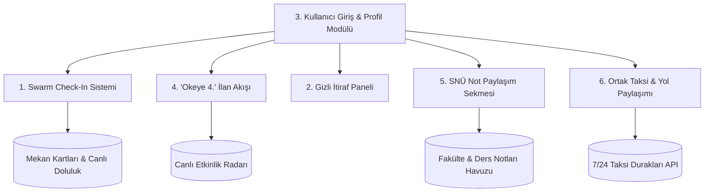

# 🚀 SinopCepte Yeni Sosyal Özellikler & Yol Haritası

Bu belge, SinopCepte portalına eklenecek yeni nesil sosyal etkileşim modüllerinin gereksinimlerini ve mimari planını içerir.

---

## 📍 1. Swarm Mantığıyla Mekanda Check-In Sistemi
Kullanıcıların bulundukları mekanlara konum bazlı veya tek tıkla sanal check-in yapabilmelerini sağlar.

* **Check-In Butonu:** Her mekan kartı ve detay modalında *"Buradayım / Check-In Yap"* aksiyonu.
* **Şu An Mekandakiler:** İlgili mekanda aktif olan kullanıcıların avatarları, rumuzları ve ne kadar süre önce check-in yaptıkları (`5 dk önce`).
* **Mekanın Mayor'ı (Müdavimi):** Bir mekana son 30 günde en çok check-in yapan kullanıcıya özel rozet ve unvan (`👑 Kordon Kahvecisi Mayor'ı`).
* **Check-In Notu & Ruh Hali:** Kullanıcının check-in yaparken kısa bir not bırakabilmesi (*"Arkada maç izliyoruz"*, *"Canlı müzik başladı"*).

---

## 🤫 2. Gizli İtiraf Paneli (Sinop Gece İtirafları)
Kullanıcıların kimliklerini ifşa etmeden Sinop gece hayatı, mekanlar ve kampüs hakkında anonim paylaşımlar yapabileceği interaktif akış.

* **Tam Anonimlik:** Kullanıcı isimleri gizlenir veya eğlenceli Sinop temalı rastgele takma adlar atanır (`Gizli Martı #104`, `Hamsi Dedektifi #28`).
* **Mekan Etiketleme (#Hashtag):** İtirafın hangi mekanla ilgili olduğu seçilebilir (`#AntikBar`, `#BurkayKafe`, `#Kordon`).
* **Dinamik Reaksiyonlar:** İtiraflara alev 🔥, kahkaha 😂, şok 😱 veya kalp ❤️ tepkileri bırakabilme.
* **Filtreleme:** `Trendler (En Çok Konuşulanlar)`, `En Yeniler`, `Mekana Göre İtiraflar`.

---

## 👤 3. Kullanıcı Giriş & Profil Paneli
Kullanıcıların kimlik oluşturabileceği, rozetlerini yönetebileceği ve etkileşim geçmişlerini görebileceği hesap yönetim alanı.

* **Kayıt & Giriş Ekranı:** Rumuz (Handle), E-posta/Şifre ile kayıt olma veya hızlı misafir modu.
* **Özelleştirilebilir Profil:** Avatar seçici, kısa biyo, Instagram/sosyal bağlantılar (isteğe bağlı).
* **Aktivite Geçmişi:** Kullanıcının yaptığı check-in'ler, paylaştığı açık ilanlar ve kazandığı rozetler.
* **Gizlilik Ayarları:** Check-in görünürlüğünü gizleme veya anonim kalma opsiyonları.

---

## 🀄 4. "Okeye 4. Aranıyor" Canlı Sosyal İlan Feed'i (Onaylı Eşleşme)
Anlık olarak masa kurmak, oyun oynamak veya etkinliğe yoldaş bulmak isteyenlerin kontrollü bir şekilde ilan açabileceği mikro-akış.

* **Kategori Rozetleri:**
  * 🀄 **Okeye 4. / Tavla:** *"Kahvede 3 kişiyiz, 1 kişi lazım"*
  * ☕ **Kahve & Muhabbet:** *"Kordon'dayım, kahve içecek arkadaş"*
  * ⚽ **Halı Saha / Maç İzleme:** *"Akşamki derbiyi izleyecek ekip"*
  * 🎸 **Konser & Canlı Müzik:** *"Bu akşamki konsere bilet var, tek gitmeyelim"*
* **Süreli İlan Mantığı:** İlanların süresi dolar (örn: 2 saat veya gece yarısına kadar), böylece bayatlamış ilanlar akışı kirletmez.
* **"Gelebilir miyim? 🙋‍♂️" Talep Butonu:** 
  * Kullanıcılar doğrudan katılmaz; ilanın altındaki *"Gelebilir miyim?"* butonuna basarak katılım isteği ve isteğe bağlı kısa bir not (*"5 dakikaya oradayım"*, *"İyi 101 oynarım"*) gönderir.
* **İlan Sahibine Özel Aday Listesi & Seçim:**
  * İlanı açan kişinin önüne gelen başvurular liste olarak düşer: Adayın avatarı, kullanıcı adı, profil güvenilirlik puanı ve gönderdiği not.
  * İlan sahibi gelenler arasından dilediği adayı seçer (**"Kabul Et / Masaya Çağır"**).
* **İletişim Kurma:**
  * Onaylanan aday ile ilan sahibi arasında iletişim köprüsü açılır (WhatsApp, hızlı telefon araması veya uygulama içi direkt mesaj). Reddedilen veya kontenjan dolunca bekleyen diğer adaylara nazik bir bilgilendirme düşer.

---

## 🎓 5. Sinop Üniversitesi (SNÜ) Kampüs & Ders Notu Paylaşım Sekmesi
Sinop Üniversitesi öğrencilerini bir araya getiren; vize/final hazırlığı, çıkmış sınav soruları ve ders özetlerinin paylaşılabileceği özel akademik dayanışma alanı.

* **Özel Navigasyon Sekmesi:** Menü ve filtrelerde ayrı bir *"🎓 SNÜ Not & Kampüs"* sekmesi.
* **Fakülte & Bölüm Filtreleme:**
  * Fakülte / Yüksekokul seçimi *(Mühendislik-Mimarlık, Fen-Edebiyat, Eğitim, Sağlık Bilimleri, Meslek Yüksekokulu vb.)*.
  * Bölüm ve Sınıf seçimi *(Örn: Bilgisayar Mühendisliği - 2. Sınıf)*.
  * Not Türü Etiketleri: `📄 Vize Özeti`, `🎯 Final Çıkmışları`, `🧪 Lab Raporu`, `📑 Hoca Slaytı`.
* **Not Paylaşım & Yükleme Modalı:**
  * Ders adı, akademisyen/hoca adı (isteğe bağlı), dönem ve kısa açıklama.
  * PDF, görsel (fotoğraf) yükleme veya bulut depolama linki (Google Drive / OneDrive / Yandex Disk).
* **Öğrenci Oylaması & İndirme:**
  * *"Bu not hayat kurtardı 👍"* oylama butonu ve toplam indirme/görüntülenme sayacı.
  * Notun altına soru-cevap ve yorum alanı (*"Hoca sınavda bu sayfayı sordu mu?"*).
* **Kampüs Rozeti:** Not yükleyip öğrencilere yardımcı olan kullanıcılara profillerinde sergileyebilecekleri *"🎓 Kampüs Notçusu"* rozeti.

---

## 🚖 6. Uzak Mesafe Ortak Taksi & Masraf Paylaşımı (Taxi Pooling)
Sinop Havalimanı, Şehirlerarası Otogar, Üniversite Kampüsü veya geç saatlerde eve dönüşlerde taksi ücretini bölüşmek isteyenlerin yol arkadaşı bulmasını sağlayan akıllı taksi paylaşım sistemi.

* **Popüler Güzergah Rozetleri:**
  * ✈️ **Havalimanı Transferi:** *"Pazar 21:30 İstanbul uçağı için merkezden havalimanına ortak taksi"*
  * 🚌 **Otogar Transferi:** *"Gece 01:00 otobüsü için çarşıdan otogara yoldaş"*
  * 🎓 **Kampüs / Yurt Hattı:** *"Bostancılı Kampüsü veya KYK yurtlarından merkeze gidiş-dönüş"*
  * 📍 **İlçeler Arası & Gece Dönüşü:** *"Gerze / Ayancık yönü veya gece kulübü çıkışı eve dönüş"*
* **Koltuk & Kontenjan Sayacı:**
  * *"2/4 Koltuk Dolu (2 Kişi Aranıyor)"* rozeti.
  * Tahmini bütçe paylaşımı *(Örn: Taksi ~400 TL / Kişi Başı ~100 TL)*.
* **"Koltuğa Talibim / Gelebilir miyim? 🙋‍♂️" Onayı:**
  * Katılmak isteyen kişi biniş noktasını belirterek talep gönderir.
  * İlan sahibi adayı onaylar; aralarında buluşma konumu ve saat koordinasyonu sağlanır.
* **Taksi Durağı Entegrasyonu:**
  * 4 koltuk tamamlandığında sistemdeki kayıtlı taksi durakları *(Meydan Taksi, Barış Taksi vb.)* tek tıkla aranarak ortak noktaya taksi çağrılır.

---

## 🛠️ Uygulama Planı Önerisi

